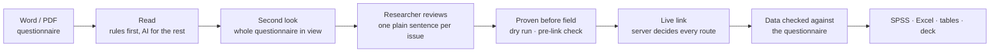

# DVV Research Cloud

**A client's questionnaire in, a fielded survey and trustworthy data out — with
every decision shown, checked, and explained.**

A market-research study starts as a Word document written for a human scripter:
forty pages of questions, answer lists, "ask only if" notes, screen-outs, masks
and pipes. Today someone rebuilds that by hand in Decipher or Qualtrics, over
days, and the mistakes surface in field — after real money has been spent on
real respondents.

DVV Research Cloud reads that document the way a senior scripter does, builds
the survey, proves its logic before anyone sees it, runs the link, and then
checks every respondent's answers against the questionnaire they were collected
under. It does this deterministically wherever it can, so the same document
always gives the same answer and every answer points back to a line of the
document.



---

## What it does

**1 · Reads the questionnaire.** Word or PDF, in both conventions agencies use:
prose (`Q7. How satisfied… [ASK IF Q3=1]`) and spec tables (`Q Name:` /
`Response list:` / `Among who:`). Out come questions, types, answer lists with
their real punch codes, bases, screen-outs, grids, loops, carousels, constant
sums, masks, pipes, rotation, quotas and hidden variables — each with a note
saying which line of the document it came from. Tracked changes and
strikethrough are honoured.

**2 · Takes a second look, with the whole questionnaire in mind.** After every
question is read, each flagged one is revisited the way a senior scripter
would: stale alarms are cleared, causes the document itself settles are fixed
by rule, and the rest go to an open-weight model shown the questions it names,
its neighbours and a cleanly read question of the same kind. A model's answer
may only use wording the document contains, and is kept only if the same checks
that raised the flag now find less wrong. The reviewer sees one sentence per
question — *fixed automatically* (undo), *fix ready* (apply), *note*, or *needs
you* with the recommended next step — instead of a row of flag codes.

> **A real example.** A Google Ads questionnaire says, for a rating grid,
> `[INSERT SELECTIONS FROM DA_VID_EFFIC]` — naming the grid itself, a copy slip.
> The system notices the self-reference, finds that `DA_VID_MEASURE` just before
> it holds the list and is asked of the same people, reads the 10-point scale
> from the response list, parses the audience `DA_PLACEMENT = 3 and/or 4`, and
> offers the finished grid with one button. A person still decides; they no
> longer have to work it out.

**3 · Learns your house style.** When a reviewer corrects a misread, they can
teach the convention instead ("in this client's documents, this phrase means a
multi-select"). The lesson applies to the whole questionnaire at once and to
every future document of that format. A taught pattern is a literal fragment,
never a regular expression — safer, and a skill a research executive already has.

**4 · Proves the survey before anyone takes it.** Four independent gates stand
between a mistake and a respondent: review flags that block approval, a dry run
that drives synthetic respondents through every rule, a server-side pre-link
check that can refuse to create the link, and a soft-launch hold so the first
completes are checked before full field.

**5 · Runs the link.** One question per screen, built for a phone. Screen-outs,
quotas, masks, pipes and block rotation are all decided on the
server, never in the respondent's browser. Rotating blocks and MaxDiff versions
are assigned least-fill, so arms stay balanced across the sample. Vendor redirects use the status
codes panels expect; paradata (device, place check) is recorded with the IP
hashed, never stored.

**6 · Checks fielded data against the questionnaire.** Give it the
questionnaire and a data export — from this system or from Decipher, Qualtrics
or anyone else — and it finds, respondent by respondent: answers outside the
base, completes who match a screen-out, "None of these" ticked with other
answers, more answers than allowed, totals that don't add up, answers outside a
mask, and codes the list never offered. Document codes and script codes are
joined by answer label, so a reversed or renumbered scale is never reported as
an error.

**7 · Delivers.** A labelled `.sav` with its codebook (value labels, measure
levels, declared missing codes), `.xlsx`, weighted crosstabs with significance
letters, verbatim coding with a reusable codeframe library, an Excel deck, a
read-only client link, and a copilot that answers questions about the project
and acts only through cards a person confirms.

## Why it is built this way

- **Deterministic first.** Parsers that know market-research conventions read
  most of a questionnaire with no AI at all. Same document, same answer, no
  cost, and a line of the document to point at when someone asks why.
- **Verified, not just automated.** The industry's open problem is trust — bad
  data and AI that can't show its work. Every reading carries its evidence,
  every survey is proven before field, and every respondent can be checked
  against the instrument.
- **It says what it could not read.** A guessed base is worse than no base, so
  an unclear rule is shown to a person with the reason, never silently applied.
- **Client data stays where it belongs.** One private stack per client;
  open-weight models only (Qwen3-32B on AWS Bedrock, Mumbai region by default) — no OpenAI or
  Anthropic models in the product. Client questionnaires never go to free AI
  tiers.
- **Measured on real documents.** Every change is scored against blind expert
  readings of real client questionnaires, item by item, before it merges.

## Measured

Against blind expert readings of six real client questionnaires — 372
questions — scored strictly: one differing attribute fails the question.
AI switched off, so these are the deterministic floor.

| | Start of October | Now |
|---|---|---|
| Survey link behaves exactly as the document says | 145 | **197** |
| Question read field-perfect | 101 | **166** |
| Document mistakes caught and flagged | 47 | **60** of 169 |

Most remaining differences come from a few causes, several of them open product
decisions (required by default, keep "Other" last when the document is silent) —
all listed in [`docs/CHANGE_TRACKER.md`](docs/CHANGE_TRACKER.md).

| On fielded data (five real studies) | |
|---|---|
| False alarms removed while building the data check | Bubble 72 → 19, Vivo 43 → 6, TRD1 12 → 1 |
| Agreement with an independent audit | 6 of 9 findings, same respondents; the other 3 traced to the reference or the document |
| Flagged questions after the second look | 106 → 80, every one with a next step |
| Public questionnaires read blind (Federal Reserve SHED) | 3 → 104 questions found, 93–97% matching the real data columns |

**1,801 backend tests and 123 web tests**, each named for a behaviour a person
would notice.

## Scope

**Does**

- Word/PDF questionnaires, prose and spec-table conventions
- Single, multi, single-answer grids, numeric, open text, dropdown, ranking,
  info screens; constant sum; loops and carousels; "Other, specify" text boxes
- Routing, screen-outs, section paths, masking, piping, list sources, answer
  conditions, randomisation with anchors, least-fill block rotation, quotas
- MaxDiff design and screens
- Preflight, dry run, test links, soft launch, vendor redirects, paradata
- Fielded data checked against the questionnaire, per respondent
- `.sav` (in and out), `.xlsx`, weighted crosstabs, significance testing,
  tracking, verbatim coding, client share links
- Self-hosted per client — one Compose stack, the client's data never leaves it

**Not yet** — see [`docs/ROADMAP.md`](docs/ROADMAP.md) and
[`docs/PRODUCT_STRATEGY.md`](docs/PRODUCT_STRATEGY.md)

- Multi-select grids (`GRID_MULTI`), image and video stimulus
- MaxDiff analysis (utilities) and conjoint
- Multi-language, panel APIs beyond redirect templating

**Next milestone:** the first client study fielded end to end. Every number
above is measured on real client documents and real client data files; the
first full run through our own link is the proof still to come.

## Where it is going

The direction is **verified research**: logic proven before field, respondents
verified as real and consistent (typing, timing and logic evidence already in
the exports), every number traceable to rows and a rule, and every sentence of
insight cited to a number. Seven pillars, with the evidence behind each, are in
[`docs/PRODUCT_STRATEGY.md`](docs/PRODUCT_STRATEGY.md).

## Quickstart

```bash
python3 -m venv .venv && source .venv/bin/activate
pip install -r requirements.txt
pytest                       # 1801 tests
cd web && npm install && npm run dev
```

Deployment: [`DEPLOY.md`](DEPLOY.md) · demo: [`MVP_DEMO.md`](MVP_DEMO.md)

## Layout

```
src/
├── core/        # the canonical model — SurveyDefinition, Question, DataMap
├── intake/      # readers: .docx, .pdf, tabular, tracked changes
├── adapters/    # external formats in and out (SPSS)
├── engines/
│   ├── questionnaire/   # reading, comprehension, second look, correction loop (46 modules)
│   ├── fielding/        # preflight, dry run, quotas, rotation, MaxDiff design, paradata
│   ├── qc/              # data vs questionnaire, condition audit, cleaning, fraud
│   ├── tabs/            # crosstabs, weighting, significance, tracking
│   ├── coding/          # verbatim coding, codeframe library
│   ├── analysis/        # pivots, charts, quality
│   └── rag/             # per-study embeddings for the copilot
├── renderers/   # SurveyJS compiler, Excel deck
└── ai/          # model router — open-weight models only
api/             # FastAPI
web/             # React review + respondent app
```

**Iron rule:** adapters map in → engines compute over → renderers map out. No
engine reads a source file format directly.

## Documentation

| File | What it is |
|---|---|
| [`docs/METHODS.md`](docs/METHODS.md) | Every technique, model and method, from first principles — start here |
| [`docs/PRODUCT_STRATEGY.md`](docs/PRODUCT_STRATEGY.md) | Where the product is going: "verified research", seven pillars |
| [`docs/CHANGE_TRACKER.md`](docs/CHANGE_TRACKER.md) | Every change with its measurement; open decisions and known issues |
| [`docs/RESEARCH_TASKS.md`](docs/RESEARCH_TASKS.md) | Research tasks for the team, each with what to hand back |
| [`docs/artifacts/`](docs/artifacts/README.md) | Archive of every published write-up (briefing, audits, walkthrough) |
| [`docs/ROADMAP.md`](docs/ROADMAP.md) | What is left, ordered, split by what compounds and what does not |
| [`docs/questionnaire-comprehension.md`](docs/questionnaire-comprehension.md) | How a questionnaire is understood, and what is still not understood |
| [`docs/CHANGELOG-questionnaire-comprehension.md`](docs/CHANGELOG-questionnaire-comprehension.md) | Build log — why each parser decision exists |
| [`docs/CHANGELOG-correction-loop.md`](docs/CHANGELOG-correction-loop.md) | Build log — founders teaching the parser |
| [`docs/LIFECYCLE_AND_ARCHITECTURE.md`](docs/LIFECYCLE_AND_ARCHITECTURE.md) | Study lifecycle and architecture |
| [`docs/WORKFLOWS.md`](docs/WORKFLOWS.md) | How the pieces are used together |
| [`docs/FIRST_STUDY.md`](docs/FIRST_STUDY.md) | Runbook for fielding the first real study end to end |
| [`docs/ARCHITECTURE-agents.md`](docs/ARCHITECTURE-agents.md) | Chat specialists and the model router |
| [`DEPLOY.md`](DEPLOY.md) | Per-client Compose bundle, licensing |
| `docs/obsidian-vault/` | **Stale (July 2026)** — the tab-engine phase. Kept for history. |

## Conventions

Conventional commits · feature branches, never direct to `main` · `pytest` and
`ruff` clean before PR · secrets only in `.env`, never committed ·
open-weight models only · client documents and data never committed.
