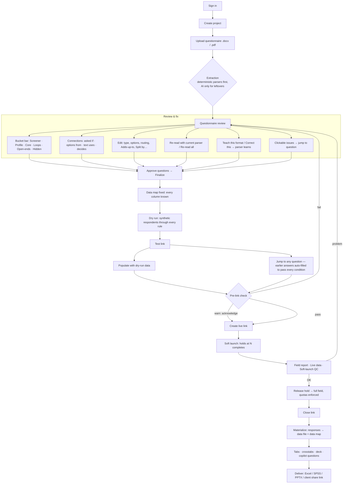
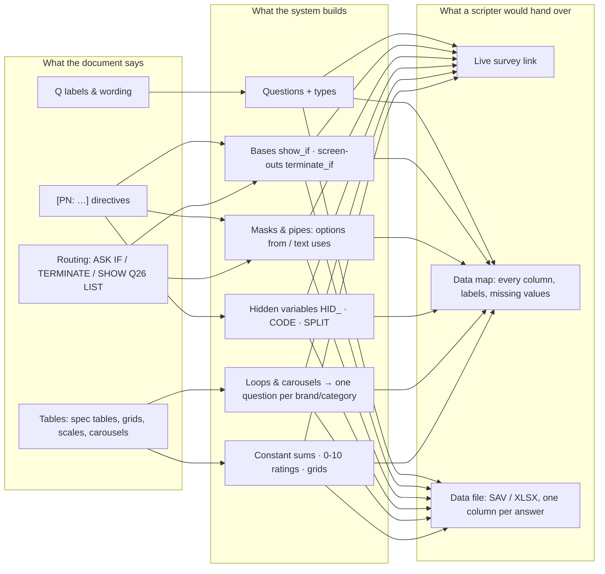
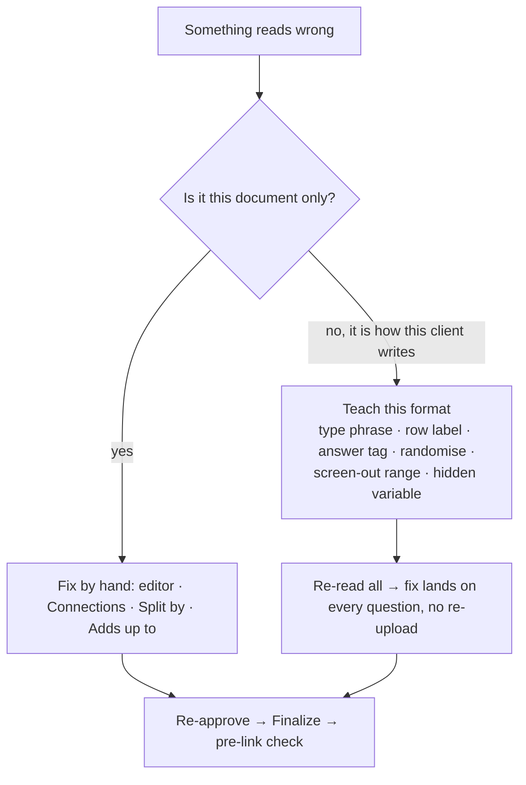
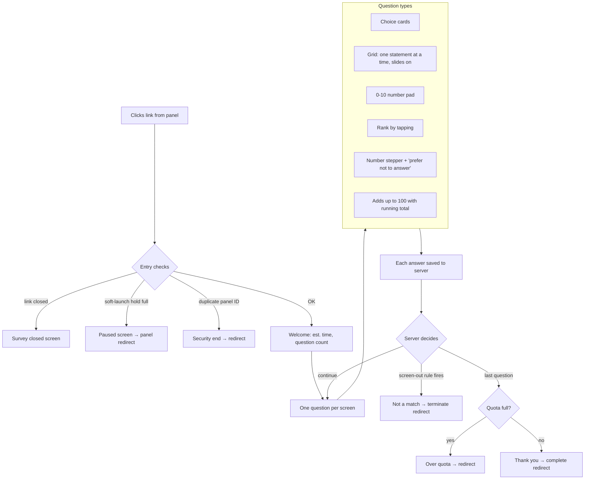
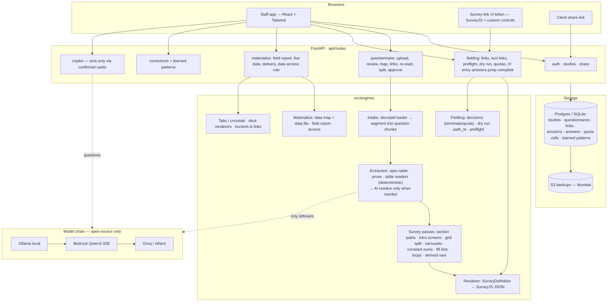
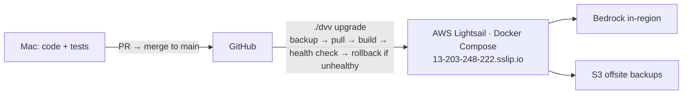

# DVV Research Cloud — Lifecycle & Architecture

How one study moves through the platform, seen from each person who touches it,
and the system underneath. Diagrams are Mermaid (render on GitHub / VS Code).

---

## 1. Who uses it

| Role | Who | Can do |
|---|---|---|
| **Owner** | Runs the account | Everything; sees respondent data from approval |
| **Founder** | Methodology lead | Corrections + teaching the parser; sees data from approval |
| **Analyst** | Research exec / DP | Review, approve, links, quotas, tabs; sees data after soft-launch hold or a filled quota |
| **Reviewer** | Checker | Reads and flags; limited writes |
| **Respondent** | Panel member / customer | Answers the survey link — no account |
| **Client** | End customer | Read-only share link to the study's output |

---

## 2. The lifecycle of one study (single-user view)

**What stops a mistake reaching a respondent**

1. Review screen issues list + blocking flags (Finalize refuses until resolved).
2. Dry run (conditions that never fire, questions never reached).
3. Pre-link check — enforced on the server; a real link is refused on failures unless "Create anyway" (logged).
4. Soft launch hold + QC on the first completes.

---

## 3. Researcher / scripter POV (market-research developer)

**Daily loop for the developer**

---

## 4. Respondent POV (what a panel member experiences)

Rules are **server-authoritative**: the browser never decides who qualifies.
Hidden/computed questions are never shown; masks and pipes are applied live.

---

## 5. Architecture

**Deployment**

---

## 6. Where each object lives

| Object | Created at | Stored in |
|---|---|---|
| SurveyDefinition (questions, routing, masks) | Extraction / review | `questionnaires.definition_json` |
| Data map | Finalize | computed from the definition |
| Link snapshot | Create link (pins that version) | `fielding_links.survey_json` |
| Respondent answers | Every page | `respondent_answers` |
| Disposition (complete/terminate/overquota/security) | Server decision | `respondent_sessions.status_code` |
| Taught conventions | Teach this format | learned patterns (literal phrases, never regex) |
| Synthetic data | Dry run / Populate test link | sessions marked `synthetic` on a test link only |
